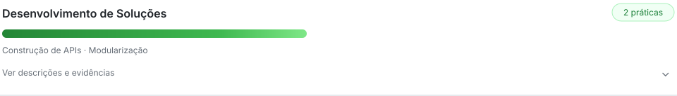
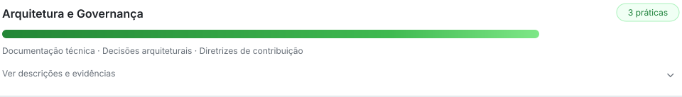

# Fábio Neres

**Profissional de tecnologia com atuação em sustentação de plataformas de IA generativa e interesse em engenharia de software.**

Este perfil reúne projetos públicos de estudo e experimentação técnica. Uso esses
exercícios para aprofundar conceitos de desenvolvimento, investigar problemas,
revisar implementações e documentar o que aprendo.

Vejo a IA como apoio ao trabalho técnico, com revisão humana, testes e atenção
às limitações de cada solução.

## Projetos públicos de estudo

Esta seção reúne repositórios públicos utilizados para praticar conceitos,
experimentar implementações e registrar aprendizados. Os códigos e as
limitações de cada exercício podem ser consultados diretamente no GitHub.

- **[Todo List API](https://github.com/neresfabio/todo-list-API)** — exercício
  de backend com Java e Spring Boot, explorando endpoints HTTP, organização
  em camadas, DTOs e operações sobre tarefas mantidas em memória.
- **[Sorteador Mocorongo](https://github.com/neresfabio/sorteador-mocorongo)** —
  projeto público de aprendizagem com HTML, CSS e JavaScript, acompanhado de
  roteiro de estudo e práticas de interação com o DOM.

## Como estudo e desenvolvo

`entender o problema` → `explorar alternativas` → `implementar` → `testar` → `revisar` → `documentar`

Utilizo projetos práticos para investigar conceitos de software e compreender
o comportamento das soluções. Durante o desenvolvimento, reviso implementações,
executo testes compatíveis com o exercício e registro limitações e aprendizados.

Quando utilizo IA, trato suas sugestões como material para análise e validação,
não como substituto do entendimento técnico ou da responsabilidade pelas decisões.

## Mapa de práticas de engenharia

Leitura consolidada de práticas observáveis em **11 repositórios públicos próprios e não forkados**: **7 práticas identificadas em 4 dimensões**. O mapa registra evidências encontradas; não atribui proficiência, senioridade ou qualidade global. Dimensões sem evidência não são exibidas.

<picture><source media="(prefers-color-scheme: dark)" srcset="./assets/engineering-practices-map/solutions-dark.svg"></picture>

<strong>Construção de APIs.</strong> Endpoints HTTP implementados em código de produção: <a href="https://github.com/neresfabio/todo-list-API/blob/main/src/main/java/com/todolist/fneres/todolist/controller/TaskController.java">TaskController.java</a>.

<strong>Modularização.</strong> Responsabilidades separadas entre controller, serviço e mapper: <a href="https://github.com/neresfabio/todo-list-API/blob/main/src/main/java/com/todolist/fneres/todolist/taskService/TaskService.java">TaskService.java</a> · <a href="https://github.com/neresfabio/todo-list-API/blob/main/src/main/java/com/todolist/fneres/todolist/mapper/TaskMapper.java">TaskMapper.java</a>.

<picture><source media="(prefers-color-scheme: dark)" srcset="./assets/engineering-practices-map/quality-dark.svg"></picture>

<strong>Análise estática.</strong> TypeScript estrito habilitado e build executado no CI: <a href="https://github.com/neresfabio/stemverse-app/blob/main/tsconfig.json">tsconfig.json</a> · <a href="https://github.com/neresfabio/stemverse-app/blob/main/.github/workflows/ci.yml">workflow de CI</a>.

<picture><source media="(prefers-color-scheme: dark)" srcset="./assets/engineering-practices-map/delivery-dark.svg"></picture>

<strong>Integração contínua.</strong> Workflow executado em push e pull request, com instalação e build: <a href="https://github.com/neresfabio/stemverse-app/blob/main/.github/workflows/ci.yml">ci.yml</a>.

<picture><source media="(prefers-color-scheme: dark)" srcset="./assets/engineering-practices-map/governance-dark.svg"></picture>

<strong>Documentação técnica.</strong> READMEs apresentam propósito e instruções de execução: <a href="https://github.com/neresfabio/nf_mocorongotech.v1/blob/main/README.md">Mocorongo Tech</a> · <a href="https://github.com/neresfabio/sorteador-mocorongo/blob/main/README.md">Sorteador Mocorongo</a> · <a href="https://github.com/neresfabio/stemverse-app/blob/main/README.md">StemVerse</a>.

<strong>Decisões arquiteturais.</strong> Escopo e decisões aprovadas documentados: <a href="https://github.com/neresfabio/rtv-reserva/blob/main/docs/arquitetura/README.md">arquitetura</a> · <a href="https://github.com/neresfabio/rtv-reserva/blob/main/docs/residencia/estado.md">estado do projeto</a>.

<strong>Diretrizes de contribuição.</strong> Fluxo, padrões e validações documentados: <a href="https://github.com/neresfabio/sorteador-mocorongo/blob/main/CONTRIBUTING.md">Sorteador Mocorongo</a> · <a href="https://github.com/neresfabio/stemverse-app/blob/main/CONTRIBUTING_Version2.md">StemVerse</a>.

*Comprimento das barras é apenas visual; as contagens são exatas e não representam proficiência.*

## Tecnologias e práticas

**Tecnologias demonstradas nos projetos públicos:**
`Java` `Spring Boot` `Maven` `JavaScript` `HTML` `CSS`

**Conceitos em estudo:**
`APIs HTTP` `DTOs` `organização em camadas` `DOM`
`validação de entradas` `testes` `documentação técnica`

As tecnologias e os conceitos acima podem ser explorados nos repositórios
públicos, sem representar uma classificação de proficiência.

## Contato

[LinkedIn](https://www.linkedin.com/in/fabioneresdejesus/)
